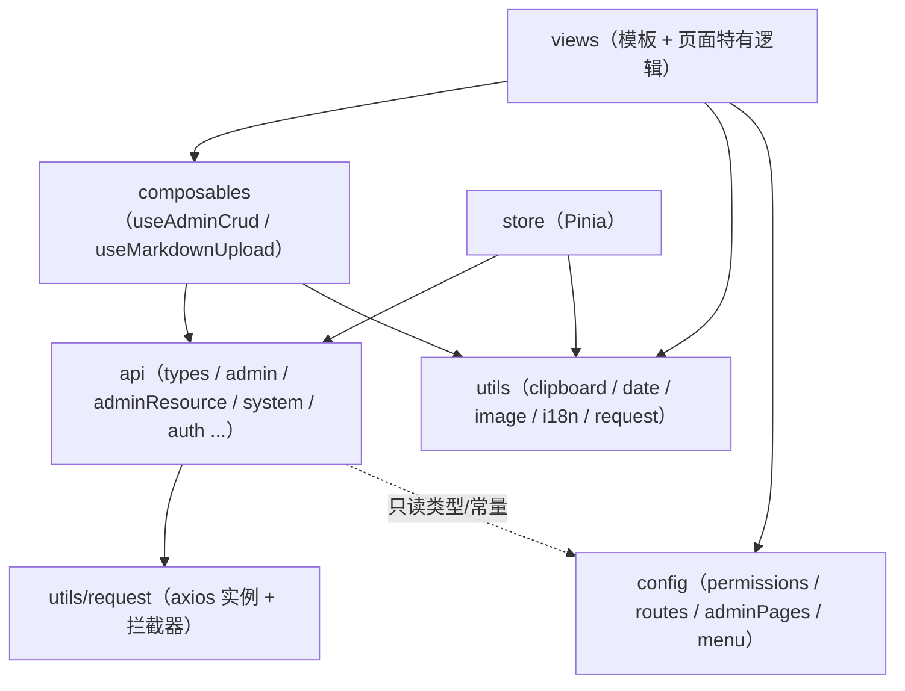

## 用户需求

对 `d:/lzkgit/my_blog_`（Vue3 + TS 个人博客前端）做一次以「代码低耦合、方便维护、增加注释」为目标的结构化重构。

## 已确认的范围与约束

- **改造范围**：核心层（api / types / store / utils / config）重构 **+** 后台 CRUD 复用抽取（改造 9 个后台 CRUD 页面与 3 处图片上传代码，约 1350 行重复逻辑）。
- **行为约束**：**完全不变**。界面 DOM、交互流程、请求 URL 与参数、字段命名、后端契约、提示文案、表格列、校验规则一律保持原样；任何差异都视为回归缺陷。本次只做结构调整与注释补齐，不顺手改 UI、业务逻辑或文案。
- **注释规范**：三级中文注释 —— ①文件头职责说明（被谁引用 / 路径约定 / 维护注意 / 变更记录）；②导出项 JSDoc；③复杂逻辑处行内注释。不写解释 TypeScript 语法本身的废话注释。
- **验收标准**：`npm run build`（内含 `vue-tsc` 类型检查 + `vite build`）零错误通过。后端不在本工作区、不做联调。

## 核心功能内容

1. **消除重复**：9 个后台页面（用户/角色/菜单/导航/文章多语/文章/作品/文章分类/作品分类）复制同一套「搜索卡 + 工具栏 + 表格 + 弹窗表单 + 批量删除」骨架，抽取为配置驱动的通用 CRUD 逻辑，页面只保留自身模板与业务差异。
2. **统一上传**：3 份重复的图片上传（扩展名白名单、5MB 上限、错误提示、401 提示）收敛为一个共享组件 + 一处常量。
3. **收敛类型**：`any` 从 130 行降到接近 0；`MenuItem` 与 `SysMenuVo` 合并为一个菜单类型；`I18nMap` 不再向消费方泄漏 `any`；后端行数据统一为 `Record<string, unknown>` 基类型。
4. **收敛工具**：剪贴板回退、日期格式化、图片地址换算、上传常量、权限串、后台路由推导各自归位到唯一出处。
5. **清理死代码**：无引用的类型、无人调用的导出、未使用的变量与 import。
6. **修正注释与实现不一致的 7 处**，并为全项目补齐三级中文注释（含 `<style>` 块分段注释）。
7. **可视化效果**：界面与交互零变化，重构前后逐页像素与流程一致。

## 技术栈

沿用现有栈，不新增任何依赖：Vue 3.4（`<script setup>` + Composition API）、TypeScript 5.4、Vite 5、Pinia 2、vue-router 4、axios 1.6、Element Plus 2.6、Tailwind 3 + Less、dayjs（已是依赖但仅用 1 处，本次统一复用）。

必须保持不变的项目约束：

- `vite.config.ts:42-47` 的 `manualChunks`（全部 node_modules 合并为 `vendor`）用于消除跨 chunk 循环依赖 TDZ 报错，**禁止改动/移除**。
- 开发态 Vite proxy `/api`、`/uploads` → `http://localhost:9997`（`vite.config.ts:20-31`）；生产态 Nginx 反代 `/api` → 9997。**前端请求路径一律不得改动**。
- `@` → `src` 别名（`vite.config.ts:9-13`）。

## 实施策略

### 总体思路

在现有「视图 → composables → api → utils/request」分层上，**新增一层"共享逻辑层"**（`composables/` + `utils/` + `config/`），把散落在页面里的**数据交互骨架**上移为配置驱动的 composable，把**跨页面复用的常量与纯函数**下沉为 `utils/` / `config/` 单例模块。视图层只保留「模板 + 页面特有逻辑」，请求依旧全部经 `@/api`，分层方向不变、依赖不反转。



### 关键技术决策

**决策 1：CRUD 骨架用「配置驱动 composable」而非「schema 驱动页面渲染」**
`src/views/admin/crud/index.vue` 已是 schema 驱动的雏形，但仅服务 2 个资源；若强行把 9 个页面改造成 schema 渲染，需要为每个资源描述字段/列/表单，改造面与回归风险远大于收益，且要求「行为完全不变」下表单校验、动态校验规则（user 的 password 仅新增必填）、详情回填兜底逻辑很难逐一对齐。
因此选择**配置驱动 composable**：composable 只负责「列表拉取 / 查询参数过滤 / 多选 / 弹窗开关 / 表单容器 / 提交 / 批量删除」这一层**跨页面完全同构**的骨架；每页通过配置项声明差异点（接口函数、主键字段、默认表单、payload 组装、详情回填、删除文案、日志前缀），模板、表格列、搜索项、`rules`、页面特有按钮全部留在页面内。

- 收益：9 个页面各减少约 120–150 行重复逻辑，行为可逐条对照还原。
- 代价：需要为每页写一份配置（约 20–40 行），总代码量下降但页面仍保留可读性；composable 需严格「零隐式行为」，所有差异必须显式配置。

**决策 2：composable 不自动 `onMounted`，由页面保留 `onMounted(getList)`**
现状 9 个页面均在 `onMounted` 里拉列表（project 页还额外拉分类下拉）。若 composable 内部自动挂载，将与页面 `onMounted` 形成双调用或顺序不确定，违反「行为完全不变」。因此 composable 只暴露 `getList`，挂载点保留在页面。

**决策 3：`requestRaw` 与 `service` 合并为「拦截器工厂 + 开关」，不改变对外语义**
`src/utils/request.ts:73-110` 的 `requestRaw` 把请求/响应/401 逻辑抄了 37 行。改为 `createHttpInstance({ unwrap: boolean })` 工厂：请求拦截器（注入 JWT）与错误处理（401 登出 + ElMessage）共用；响应拦截器仅差「是否剥掉 `data` 外壳」这一个开关。导出名 `service`（默认，剥 data）与 `requestRaw`（不剥）保持不变，`src/api/auth.ts:4,38` 的登录逻辑无需改动，运行时行为逐条等价。

**决策 4：通用 CRUD 的 `resource` 保持 `string` 不收窄**
`src/views/admin/crud/index.vue` 存在按动态资源名调用通用 CRUD 的分支（`isDedicatedResource` 为假时），把 `adminList` 的 `resource` 收窄成字面量联合会导致该动态调用编译报错。因此**仅补注释说明后端白名单**（nav、project_category、project、article_category、article、article_i18n），不收窄类型，避免破坏动态兜底页。

**决策 5：菜单类型统一为 `MenuVo`，`MenuItem` 保留为别名**
`src/api/auth.ts:7-20` 的 `MenuItem` 与 `src/api/system.ts:90-105` 的 `SysMenuVo` 描述后端同一张 `sys_menu` 表。统一为 `MenuVo`（定义在 `src/api/types.ts`），`auth.ts` 与 `system.ts` 共同引用；`export type MenuItem = MenuVo` 保留旧名兼容 `src/store/user.ts:7`、`src/config/menu.ts:5` 等既有引用，运行时零影响（纯类型别名）。

**决策 6：`I18nMap` 改为 `Record<string, string | string[]>`**
`src/api/types.ts:13` 的 `Record<string, any>` 是 `any` 泄漏到类型层的根因。后端 `zh/en` 对象内既有 `title: string` 也有 `tags: string[]`，故改为 `Record<string, string | string[]>`。**风险与处置**：`ProjectVo.zh` 消费方（`src/store/portfolio.ts:16-54` 的 normalize、`src/components/PortfolioGrid.vue`）当前直接读 `.zh/.en`，改动后会出现类型不匹配——统一改为经 `src/utils/i18n.ts` 的 `pickText` 取值（`src/api/types.ts:4-5` 早已规定该约定，属"规范与实现对齐"），并保持 `pickText` 的取值结果与原直接读取**逐字段等价**（单语模式取平铺字段、双语模式取对应语言），确保渲染结果不变。

**决策 7：文案类型归位到 `src/data/site.ts`，前台页面改为 import**
`SocialLinks` / `ContactContent` / `PortfolioPageContent` / `ArticlesPageContent` / `Song` 目前在 5 处重复定义，且 `src/types/index.ts:4-6` 的注释与实际不符。新建 `src/data/site.ts` 统一导出这 5 个类型（纯类型 + 前台静态文案），5 个消费方（dashboard / contact / portfolio / articles / MusicPlayer）改为 import，删除 view 内的重复 interface。`src/types/index.ts` 删除零引用的 `Skill` 与与 `api/types.ts` 重复的 `NavItem`。

**决策 8：枚举常量替换硬编码字符串**
`src/components/PortfolioGrid.vue:35,40,107` 与 `src/views/portfolio/components/ProjectDetailModal.vue:20,205-206` 用 `'Development'` / `'Photography'` 硬编码，绕过 `src/types/index.ts:11-18` 的 `Category` 枚举。改为引用枚举常量（枚举值本身不变，故渲染结果不变）。`src/store/articles.ts:16` 的 `as` 断言改为显式映射 + 兜底（未知值落回默认值，不抛错）。

**决策 9：上传组件提升为共享组件，并用 prop 抹平细微 UI 差异**
`src/views/admin/crud/ImageUpload.vue` 与 project/article 页内联上传块逻辑完全相同（`ALLOWED_EXT` / `MAX_SIZE` / `ACCEPT` / `beforeUpload` / `handleUpload`），差异仅两点：共享组件多一行「无上传权限（缺少 blog:upload:edit）」提示、且预览区 `preview-teleported` 行为一致。因此把组件提升到 `src/components/ImageUpload.vue` 并新增 `showTip?: boolean`（默认 `true`），project/article 传 `:show-tip="false"` 以保持原样；上传校验常量与 `toAbsoluteUrl` 统一到 `src/utils/image.ts`。保存值仍为后端返回的**相对 URL**（`res.url`），与现状一致（`useMarkdownUpload` 的绝对地址转换只作用于 Markdown 正文，不受影响）。

**决策 10：`clipboard` / `date` / `image` / `permissions` / `routes` 各自单一出处**

- `src/utils/clipboard.ts`：`writeClipboard(text)`（clipboard API → textarea + execCommand 回退），替换 `src/views/contact/index.vue:135-158` 与 `src/components/DailyEnglish.vue:114-131` 两份拷贝。
- `src/utils/date.ts`：基于已有 dayjs 封装 `todayStamp()` / `currentYear()` / `formatDate`，替换 `src/components/DailyEnglish.vue:91-95` 手写 `padStart`、`src/layout/index.vue:51`、`src/views/admin/dashboard/index.vue:60`（保持原格式串 `'YYYY 年 MM 月 DD 日 dddd'`，输出完全一致）。
- `src/config/permissions.ts`：`PERM.UPLOAD = 'blog:upload:edit'`，替换 4 处硬编码（`useMarkdownUpload.ts:30`、`crud/ImageUpload.vue:77`、`content/project/index.vue:319`、`content/article/index.vue`）。
- `src/config/routes.ts`：`adminRouteByResource(resource)`，与 `src/router/index.ts:30-32` 的 `'/admin/' + component.replace(/^blog\//,'')` 规则同源，替换 `src/views/admin/dashboard/index.vue:72-75,79-80` 的硬编码路径（生成结果与原硬编码字符串一致，避免 404 风险）。

## 行为不变的保障机制（关键）

改造采用**「先抽取、后逐页对照、再删冗余」**三步法，每页改造必须逐条核对下列清单，未核对通过不得进入下一批：

| 维度 | 核对项 |
| --- | --- |
| 请求 | URL、方法、query 参数（键名与过滤规则：剔除 `''`/`undefined`/`null`）、body 字段集合与顺序无关性 |
| 响应处理 | 列表 `Array.isArray` 兜底、`total = list.length`（后端全量无分页）、失败时列表置空 + total 归零 |
| 表单 | `defaultForm()` 字段与初值、`rules`（含 `user` 页 `isEdit` 动态必填）、校验失败静默返回 |
| 回填 | 行数据回填 → 详情覆盖的顺序；详情失败仅打日志不阻塞（沿用行数据兜底） |
| 提交 | 新增/修改分支判定（`editingId === null`）、成功提示文案（`新增成功` / `修改成功`）、成功后关弹窗并刷新列表 |
| 删除 | 单行/批量分支、二次确认文案逐字一致、`Promise.allSettled` 统计与「成功 N 条，失败 M 条」提示 |
| 权限 | `editable` 判定方式（`hasPerm('system:user:edit')` vs `canEdit('nav')`）保持原样，不统一改写 |
| 日志 | `console.error('[admin] xxx失败', e)` 前缀文案保持原样（`logLabel` 配置传入） |


**分批与回退**：共 4 批，每批结束执行一次 `npm run build`，构建失败即停在该批修复，不进入下一批；每批只触碰明确列出的文件，不做无关格式化、不升级依赖、不改 `vite.config.ts`。

## 性能与可靠性

- **运行时零开销**：composable 只做逻辑上移，不新增请求、不改渲染结构、不引入 watch/effect 副作用；`getList` 仍是单次请求，查询参数过滤逻辑原样迁移（O(查询字段数)）。
- **上传校验前置**：类型白名单与大小上限仍在 `before-upload` 阶段拦截，不合规不发请求（保持现状）。
- **删除并发度不变**：仍用 `Promise.allSettled` 并发删除，不改为串行（避免行为/耗时变化）。
- **类型层收紧的运行时影响为零**：`Record<string, unknown>` 等仅作用于编译期；`vue-tsc` 通过即证明消费方已正确收窄。
- **构建体积**：`manualChunks` 保持不变，新增 composable/utils 均为小体积模块，不新增第三方依赖。

## 架构设计

### 分层职责（改造后）

- **views**：仅模板 + 页面特有逻辑（表格列、搜索项、`rules`、页面专属按钮如文章 Markdown 导入、分类下拉加载）。
- **composables**：`useAdminCrud`（后台 CRUD 骨架）、`useMarkdownUpload`（Markdown 图片上传回调）—— 只做编排，不直接拼 URL。
- **api**：唯一的后端出入口；`paths.ts` 统一管理后台资源路径；`types.ts` 集中 VO 与菜单类型；`index.ts` 作为统一出口（补齐 `dailyEnglish` 导出）。
- **store**：维持现状（不写死 URL、`normalize()` 归一化、零交叉依赖），仅做类型具名化与注释修正。
- **utils**：`request`（axios + 拦截器工厂）、`i18n`（`pickText`）、`clipboard`、`date`、`image`（上传常量 + `toAbsoluteUrl`）。
- **config**：`adminPages`（页面注册表）、`menu`（图标 + 路由推导）、`permissions`（权限串）、`routes`（后台路由生成）。

## 目录结构

### 结构摘要

改动集中在 4 处：新增 `src/utils/{clipboard,date,image}.ts`、`src/config/{permissions,routes}.ts`、`src/api/paths.ts`、`src/data/site.ts`、`src/composables/useAdminCrud.ts`、`src/components/ImageUpload.vue`；改造 `src/api/*`（类型收紧与路径统一）、9 个后台 CRUD 页面、project/article 上传块、5 个前台页面的类型引用；清理死代码并全量补注释。不新增依赖，不改构建配置。

```
project-root/
├── src/
│   ├── api/
│   │   ├── paths.ts                # [NEW] 后台接口路径单一出处。导出 ADMIN_API_PREFIX 常量与 adminPath(resource, id?) 助手，内部统一 encodeURIComponent 与 id 空值处理；被 admin.ts 与 adminResource.ts 共同引用，消除 6 处 '/api/admin/' 拼接。文件头注释说明后端资源白名单与「通用 CRUD 用下划线列名、专用接口用驼峰字段」的命名约定。
│   │   ├── admin.ts               # [MODIFY] 后台通用 CRUD 封装。改用 adminPath()；5 个函数返回值由 any/any[] 改为 AdminRow/AdminRow[]（Record<string, unknown> 基类型），参数 Record<string, any> 改 Record<string, unknown>；补齐每个导出项 JSDoc 与「resource 必须命中后端白名单」的警示注释；保留 adminUploadImage 与 AdminUploadResult 不变。
│   │   ├── adminResource.ts        # [MODIFY] 后台专用 CRUD 封装。删除本地 path() 助手改为复用 api/paths.ts 的 adminPath；保留 DEDICATED_RESOURCES 与编译期同步断言机制不动；补齐导出项注释。
│   │   ├── types.ts                # [MODIFY] 后端 VO 类型集中地。I18nMap 由 Record<string, any> 改为 Record<string, string | string[]>；新增 MenuVo（菜单树节点，含 children 自引用）并说明与 sys_menu 表的对应关系；保留 PageResult/LangParam 等既有导出。
│   │   ├── auth.ts                 # [MODIFY] 认证接口。MenuItem 改为 MenuVo 的类型别名（export type MenuItem = MenuVo）保持既有引用不破坏；login/getInfo/getMenus/logout 运行时行为不变；补齐「被谁引用/调用约定」注释。
│   │   ├── system.ts               # [MODIFY] 用户/角色/菜单 3 套 CRUD + VO。SysMenuVo 改为复用 MenuVo（保留 SysMenuVo 别名）；核对并补齐导出 VO 类型，供后台页面替换 any；补注释。
│   │   ├── index.ts                # [MODIFY] 接口层统一出口。补 export * from './dailyEnglish'（修正「统一出口却漏导出」的不一致）；更新分层说明注释。
│   │   ├── dailyEnglish.ts         # [NEW] 由原 src/api/DailyEnglish.ts 重命名而来（camelCase 与其余文件统一）。内容基本不变：删除未使用的 element-plus locales 死导入；补齐文件头与导出项注释。需同步更新 src/components/DailyEnglish.vue 的 import 路径。
│   │   ├── site.ts / project.ts / article.ts  # [MODIFY] 仅补齐导出项 JSDoc 与「被谁引用」注释，接口 URL 与字段不动；修正 site.ts 中引用不存在的 src/data/home.ts 的错误注释。
│   ├── utils/
│   │   ├── request.ts              # [MODIFY] axios 封装。抽出 createHttpInstance({ unwrap }) 拦截器工厂：请求拦截器（注入 JWT）、错误处理（401 登出 + ElMessage 提示）为共用逻辑，响应拦截器仅差是否剥 {code,msg,data} 外壳；导出名 service（默认剥 data）与 requestRaw（不剥）及其语义完全不变，auth.ts 登录取 msg 的用法无需改动。
│   │   ├── clipboard.ts            # [NEW] 剪贴板写入工具。writeClipboard(text): Promise<boolean>，优先 navigator.clipboard，失败回退 textarea + execCommand（复刻 contact 与 DailyEnglish 的现有回退实现与提示语）；文件头注明被哪两处调用替换。
│   │   ├── date.ts                 # [NEW] 日期工具（基于已有 dayjs 依赖）。导出 todayStamp()（YYYYMMDD）、currentYear()、formatDate(date, 'YYYY 年 MM 月 DD 日 dddd')；集中替换 DailyEnglish 手写 padStart、layout 的 getFullYear、admin dashboard 的 dayjs 调用，输出格式与现值完全一致。
│   │   ├── image.ts                # [NEW] 图片相关纯函数与常量。ALLOWED_EXT / MAX_SIZE / ACCEPT / beforeUpload 校验（等价迁移自三份上传实现）、toAbsoluteUrl(url)（从 useMarkdownUpload 提取）；文件头说明「后端返回相对 URL、Markdown 正文需绝对地址」的既有约定。
│   │   └── i18n.ts                 # [MODIFY] pickText 保持既有签名与行为；补注释说明「单语平铺 / 双语 zh-en」两种形态与调用方约定，并显式支持显式 lang 入参以便 store 层按语言取值。
│   ├── config/
│   │   ├── permissions.ts          # [NEW] 权限串常量。PERM.UPLOAD = 'blog:upload:edit'（4 处硬编码收敛到 1 处），并列出后端种子数据不含该权限、需在 sys_permission 手工插入的维护提醒。
│   │   ├── routes.ts               # [NEW] 后台路由生成。adminRouteByResource(resource) 与 src/router/index.ts:30-32 的推导规则同源（去掉 blog/ 前缀），替换 admin/dashboard 的硬编码路径，保证生成结果与原字符串一致。
│   │   ├── adminPages.ts           # [MODIFY] 页面注册表：仅补注释，说明与后端菜单 perms 的推导关系及「动态匹配、无静态 import 的文件不可误删」约定。
│   │   └── menu.ts                 # [MODIFY] 图标映射与 menuRoutePath：类型改用新的 MenuVo，补注释，不改映射表与推导逻辑。
│   ├── composables/
│   │   ├── useAdminCrud.ts         # [NEW] 后台 CRUD 骨架 composable（本次核心新增）。以配置项声明主键字段、列表/详情/新增/修改/删除函数、默认查询条件、默认表单工厂、行数据回填、详情覆盖、payload 组装、删除确认文案、日志前缀；返回 list/loading/total/selection/showSearch/queryParams/dialogVisible/dialogTitle/saving/formRef/editingId/isEdit/form 与 getList/handleQuery/resetQuery/handleSelectionChange/openAdd/openEdit/closeDialog/submitForm/removeRows。不在内部 onMounted（挂载点保留在页面）；对空值过滤、Array.isArray 兜底、total=list.length、Promise.allSettled 批量删除等既有行为做等价实现；三级中文注释齐全。
│   │   └── useMarkdownUpload.ts     # [MODIFY] 改用 utils/image 的 toAbsoluteUrl 与 config/permissions 的 PERM.UPLOAD；补注释说明编辑器回调契约；行为不变。
│   ├── components/
│   │   ├── ImageUpload.vue         # [NEW] 通用图片上传控件（由 src/views/admin/crud/ImageUpload.vue 迁移而来）。保留缩略图预览、空态、错误提示、上传/重新上传/移除按钮与权限禁用逻辑；新增 showTip（默认 true）控制「无上传权限」提示行，使 project/article 页面可保持原样；校验与请求改用 utils/image 常量与 api/admin 的 adminUploadImage。
│   │   ├── DailyEnglish.vue         # [MODIFY] import 路径改为 @/api/dailyEnglish；剪贴板改用 utils/clipboard；删除未使用的 offset ref；修正「取句逻辑在 src/data 按第几天取模」「改为本地池随机」等与实现不符的注释；补齐导出与逻辑注释。
│   │   ├── PortfolioGrid.vue       # [MODIFY] 分类硬编码字符串改用 types 的 Category 枚举常量；补注释。
│   │   └── MusicPlayer.vue         # [MODIFY] 4 首歌曲的 /music/... 静态路径与 Song 类型迁到 src/data/site.ts；Song 类型不再本地重复定义；为约 700 行样式块补分段注释；补齐 script 逻辑注释。
│   ├── data/
│   │   ├── site.ts                 # [NEW] 前台文案类型与静态文案单一出处。导出 SocialLinks / ContactContent / PortfolioPageContent / ArticlesPageContent / Song 五个类型（保持现有字段与可选性完全一致）及首页/联系/作品/文章页的静态文案；供 5 个消费方 import，删除 view 内重复定义。
│   │   └── dailyEnglish.ts         # [MODIFY] 删除零调用的 getDailySentence() 死导出；补注释；保留句库与日期函数。
│   ├── types/
│   │   └── index.ts                # [MODIFY] 前端内部类型。删除零引用类型 Skill 与重复的 NavItem；SocialLinks/ContactContent/PortfolioPageContent/ArticlesPageContent/Song 改为从 data/site.ts 统一导出（保留 re-export 以免破坏既有引用）；修正文件头「类型在 src/data 下定义」的注释使其与实现一致；补齐导出项 JSDoc。
│   ├── store/
│   │   ├── articles.ts             # [MODIFY] 内联排序类型断言改为具名类型；分类取值按 i18n 约定显式映射 + 未知值兜底（不抛错，行为等价）；补注释。
│   │   ├── portfolio.ts            # [MODIFY] 修正残缺注释「返回的是group by title…」；补齐 normalize 流程注释；store 结构与请求方式不动。
│   │   ├── user.ts / site.ts / app.ts  # [MODIFY] 仅补注释与类型具名化，保持零交叉依赖与不写死 URL 的现状。
│   └── views/
│       ├── admin/
│       │   ├── system/user/index.vue        # [MODIFY] 改用 useAdminCrud（idField=userId、systemUser* 接口、显式 payload 三字段 + password 留空不提交、删除文案含昵称/用户名、logLabel「用户」），保留模板/表格列/搜索项/rules/权限判定/密码提示。
│       │   ├── system/role/index.vue        # [MODIFY] 改用 useAdminCrud（idField=roleId、systemRole* 接口），保留模板与页面特有逻辑。
│       │   ├── system/menu/index.vue        # [MODIFY] 改用 useAdminCrud（idField=menuId、systemMenu* 接口、树形表格保持原样）。
│       │   ├── content/nav/index.vue         # [MODIFY] 改用 useAdminCrud（通用 CRUD adminList/adminGet/...、idField=id、下划线列名 payload 四字段）。
│       │   ├── content/articleI18n/index.vue # [MODIFY] 改用 useAdminCrud（通用 CRUD、article_i18n、下划线列名）。
│       │   ├── content/article/index.vue      # [MODIFY] 改用 useAdminCrud（专用 CRUD adminResource*、idField=id、payload 取 defaultForm 全量键）；封面上传改用共享 ImageUpload 组件（show-tip=false）；保留 Markdown 编辑器、导入 MD（handleImportMd 补行为注释）、封面图集等页面特有逻辑。
│       │   ├── content/project/index.vue      # [MODIFY] 改用 useAdminCrud（专用 CRUD、idField=id、payload 取 defaultForm 全量键）；封面上传改用共享 ImageUpload 组件（show-tip=false）；保留分类下拉加载 loadCategoryOptions 与页面表单布局。
│       │   ├── content/articleCategory/index.vue # [MODIFY] 改用 useAdminCrud（专用 CRUD、AdminSaveVo<T> 泛型表单类型保留）；本地过滤 matchLocalFilter 迁入 utils 或 composable 复用。
│       │   ├── content/projectCategory/index.vue # [MODIFY] 同上，与 articleCategory 共用同一份本地过滤实现，消除重复。
│       │   ├── crud/ImageUpload.vue           # [DELETE] 已迁移至 src/components/ImageUpload.vue，原文件删除并同步更新引用方（crud/index.vue）。
│       │   ├── crud/index.vue                 # [MODIFY] 图片上传改引用 @/components/ImageUpload.vue；补注释说明其与 useAdminCrud 的职责边界（前者是 schema 驱动兜底页，后者是逻辑层 composable）。
│       │   └── dashboard/index.vue            # [MODIFY] 硬编码后台路径改用 config/routes 的 adminRouteByResource（生成结果与原字符串一致）；dayjs 调用改用 utils/date；补注释。
│       ├── dashboard/index.vue     # [MODIFY] SocialLinks/ContactContent 类型改为从 @/data/site.ts import，删除本地重复定义；补注释。
│       ├── contact/index.vue      # [MODIFY] 剪贴板改用 utils/clipboard.writeClipboard；SocialLinks/ContactContent 类型改为 import；补注释。
│       ├── portfolio/index.vue     # [MODIFY] PortfolioPageContent 类型改为 import；补注释。
│       ├── articles/index.vue      # [MODIFY] ArticlesPageContent 类型改为 import；补注释。
│       └── portfolio/components/ProjectDetailModal.vue # [MODIFY] 分类硬编码改用 Category 枚举；补注释。
├── src/layout/index.vue           # [MODIFY] 年份获取改用 utils/date 的 currentYear()；补注释。
├── README.md                      # [MODIFY] 在现有 2 行基础上补充分层架构说明、目录职责表、二次开发约定（如何新增后台 CRUD 页面：只需配置 useAdminCrud + 复制模板）与验收命令，不新建其他文档。
└── vite.config.ts                 # [不变更] manualChunks 与 dev proxy 保持原样（仅作为改造约束记录）。
```

## 关键代码结构

### 1. `src/composables/useAdminCrud.ts` 的配置契约（新增，最关键）

```ts
/** 后台行数据基类型：通用 CRUD 返回数据库行（下划线列名），字段需由页面按具体资源收窄 */
export type AdminRow = Record<string, unknown>

export interface AdminCrudOptions<T extends AdminRow = AdminRow, F extends Record<string, any> = Record<string, any>> {
  /** 主键字段名（如 userId / roleId / id），用于取 id 与 el-table row-key */
  idField: keyof T & string
  /** 列表请求：入参为已剔除空值的查询参数，返回全量数组（后端无分页） */
  fetchList: (params: Record<string, unknown>) => Promise<T[]>
  /** 详情请求（可选）：失败不阻塞弹窗，沿用行数据兜底 */
  fetchDetail?: (id: string | number) => Promise<T>
  /** 新增 / 修改 / 删除请求（可选，缺省则对应按钮不可用） */
  createFn?: (payload: Record<string, unknown>) => Promise<unknown>
  updateFn?: (id: string | number, payload: Record<string, unknown>) => Promise<unknown>
  deleteFn?: (id: string | number) => Promise<unknown>
  /** 初始查询条件（键名即后端可识别的筛选列） */
  defaultQuery?: Record<string, unknown>
  /** 表单默认值工厂 */
  createForm: () => F
  /** 行数据回填表单，默认 Object.assign(form, row) */
  fillForm?: (form: F, row: T) => void
  /** 详情覆盖表单，默认 Object.assign(form, detail) */
  applyDetail?: (form: F, detail: T) => void
  /** 提交前组装 payload，默认原样返回 form */
  buildPayload?: (form: F, isEdit: boolean) => Record<string, unknown>
  /** 弹窗标题，默认 { add: '添加', edit: '修改' } */
  titles?: { add: string; edit: string }
  /** 删除二次确认文案，默认「确认删除该条数据？」/「确认删除选中的 N 条数据？」 */
  deleteConfirmText?: (rows: T[], isBatch: boolean) => string
  /** 列表加载失败的 console.error 前缀，默认 '[admin] 列表加载失败' */
  logLabel?: string
}
```

返回值（页面直接解构绑定到模板，保持原模板变量名不变）：
`{ list, loading, total, selection, showSearch, queryParams, dialogVisible, dialogTitle, saving, formRef, editingId, isEdit, form, getList, handleQuery, resetQuery, handleSelectionChange, openAdd, openEdit, closeDialog, submitForm, removeRows }`。

### 2. `src/api/paths.ts` 的路径助手（新增）

```ts
/** 后台通用/专用接口统一前缀 */
export const ADMIN_API_PREFIX = '/api/admin/'
/** 拼接后台资源路径；id 为空时只返回资源路径，否则追加编码后的 id */
export function adminPath(resource: string, id?: string | number): string
```

### 3. 菜单与多语类型（`src/api/types.ts`）

```ts
/** 多语字段集合：单语为字符串，双语为 { zh, en }，值可能为字符串或字符串数组 */
export type I18nMap = Record<string, string | string[]>

/** 后端 sys_menu 菜单树节点（auth 与 system 两处共用同一份定义） */
export interface MenuVo {
  menuId: number
  parentId: number
  menuName: string
  menuType: 'M' | 'C' | 'F'
  orderNum: number
  path: string
  component: string
  icon: string
  perms: string
  status: string
  createTime?: string
  children?: MenuVo[]
}
```

## 实施注意事项

- **每批必跑构建**：批次划分 = ①核心层（api/types/utils/config/data）→ ②后台 CRUD composable + 9 页面 → ③上传组件共享 → ④注释补齐与验收。每批结束执行 `npm run build`，失败即停在本批修复。
- **注释书写规范**：沿用现有中文风格；文件头写「职责 + 被谁引用 + 路径/命名约定 + 维护注意 + 变更记录」；导出项写 JSDoc（用途、参数、返回值、特殊行为如「全量返回无分页」「需 xxx 权限」「字段必须是下划线列名」）；复杂逻辑（查询参数过滤、详情兜底、批量删除统计、归一化映射）写行内注释解释「为什么」而非「做了什么」。
- **注释不得漂移**：凡是本次调整了行为的注释必须同步更新，改造完成后需再核查一遍先前发现的 7 处不一致（types/index.ts:4-6、api/site.ts:4、store/portfolio.ts:74、content/article/index.vue:3、components/DailyEnglish.vue:3、api/index.ts:1-5、api/system.ts:5-6）。
- **日志规范**：沿用现有 `console.error('[admin] xxx失败', e)` 前缀式日志，保留原前缀文案；不打印 token、密码等敏感信息；不新增高频日志。
- **不做无关改动**：不升级依赖、不改 `vite.config.ts`、不改 `vite-env.d.ts` / `env.d.ts`、不调整 `styles/tokens.css` 配色体系（后台硬编码色值本次不动，避免视觉回归）、不动 `src/router/index.ts` 的动态路由注册逻辑。
- **构建产物**：`npm run build` 会覆盖 `dist/`（仓库内已有 `dist.zip` 归档，属预期行为，无需清理）。

## Agent Extensions

### SubAgent

- **code-explorer**
- Purpose: 改造收尾阶段批量核查全项目注释与实现的一致性、残留 `any`、残留硬编码常量（权限串、后台路径、分类字符串）与死代码；并交叉验证 9 个后台页面的行为对照清单是否全部落实。
- Expected outcome: 输出一份「残留问题清单（文件 + 行号 + 现象）」，据此补齐最后一轮注释与清理，确保无 `any` 泄漏、无过时注释、无遗漏的重复实现。

### Skill

- **lsp-code-analysis**
- Purpose: 在改造 `MenuVo` / `I18nMap` / `AdminRow` / `adminPath` / `useAdminCrud` 等公共符号前，用 LSP 查找全部定义与引用点，确认影响面覆盖所有调用方（含 `src/store/user.ts`、`src/config/menu.ts`、`src/api/auth.ts`、`src/views/admin/crud/index.vue` 等易遗漏处）。
- Expected outcome: 每个被改动的公共符号都有完整的引用清单与逐点确认记录，杜绝遗漏调用方导致的编译错误或行为漂移。